# Pool Master Counter

**🇬🇧 English** · [🇫🇷 Français](README.fr.md) · [🇪🇸 Español](README.es.md) · [🇭🇰 廣東話](README.zh-yue.md)

A touch-friendly pool scoring app for phone, tablet, or desktop. It runs entirely in the browser — no server, no account, no build step — and remembers everything on the device it's used on: your roster, career stats, player ratings, saved player lists, game-order rotations, tournament brackets, and daily notes.

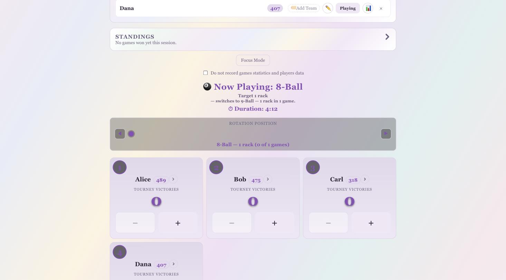

## Table of contents

- [Quick start: the Setup Wizard](#quick-start-the-setup-wizard)
- [Manual setup](#manual-setup)
- [Themes](#themes)
- [Players & saved player lists](#players--saved-player-lists)
- [Live play & scoreboard](#live-play--scoreboard)
- [Game Order (rotations)](#game-order-rotations)
- [Tournaments (single, double & round robin)](#tournaments-single-double--round-robin)
- [All Players & career stats](#all-players--career-stats)
- [Individual player page](#individual-player-page)
- [Player ratings](#player-ratings)
- [Sound](#sound)
- [Today's Notes & Day Report](#todays-notes--day-report)
- [Help & Guide](#help--guide)
- [Focus Mode](#focus-mode)
- [Backup, import/export & data safety](#backup-importexport--data-safety)
- [Names are case-insensitive](#names-are-case-insensitive)
- [Data & privacy](#data--privacy)
- [Running it](#running-it)
- [Testing](#testing)
- [Project structure](#project-structure)

## Quick start: the Setup Wizard

The fastest way to get a game going is the **🧙 Start Wizard** button at the top of the page. It walks through everything needed to start playing in five short steps, explaining each one in plain language along the way.

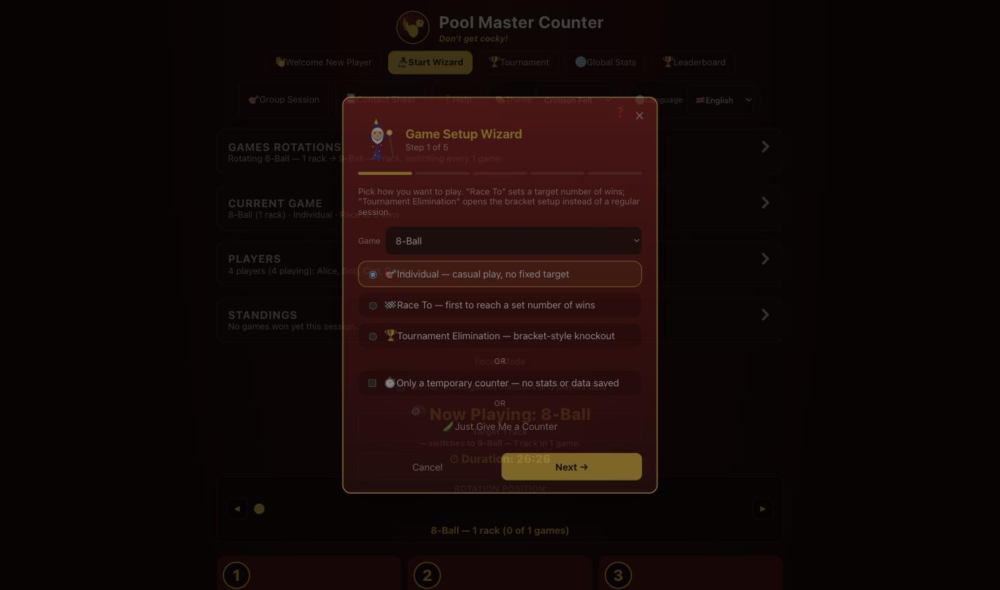

1. **Game type & format** — pick the game (8-Ball, 9-Ball, Straight Pool, One Pocket, etc.) and how you want to play:
   - **Individual** — casual play, no fixed target.
   - **Race To** — first to a target number of wins; the wizard asks for the number. This is a Tournament too — see [Tournaments](#tournaments-single-double--round-robin).
   - **Tournament Elimination** — skips straight to the bracket setup described below instead of a regular session.
2. **Players** — load an existing saved player list, add new players, or both.
3. **Playing vs. Standby** — turn "Playing" on for everyone in this game; anyone left on "Standby" sits out but stays on the roster for later. At least two players must be marked Playing to continue.
4. **Rotation** — a plain-language yes/no: "Do you want to automatically switch between game types?" Choosing yes reveals the same rotation builder described in [Game Order](#game-order-rotations); choosing no skips straight to the summary.
5. **Review & Start** — a summary of every choice made. Hitting **Start Game** applies everything, switches to [Focus Mode](#focus-mode), and closes the wizard. Choosing Tournament Elimination in step 1 changes this into **Go to Tournament Setup**, which hands off to the tournament page instead.

Canceling the wizard at any point is safe — any players you added or rotation changes you made are already saved (the same way they would be if you'd used the panels directly), so nothing is lost or rolled back.

## Manual setup

Prefer to configure things yourself instead of the wizard? The main page has the same controls laid out as panels, top to bottom: **Backup & Transfer** (collapsed by default — tap the chevron to expand), **Game Order**, **Current Game**, and **Players**.

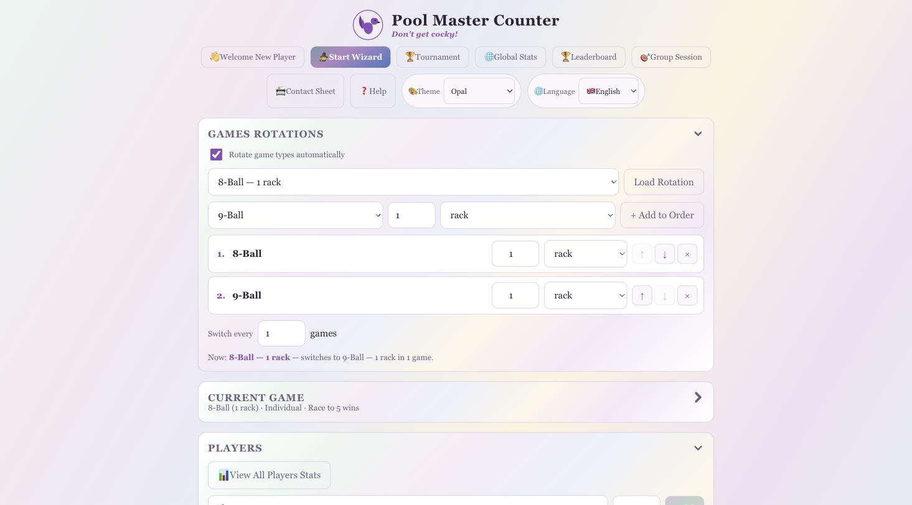

- **Current Game** — pick the game type, the target number, and its unit (rack/balls/points — adjustable independently of the game type's usual default, so e.g. One Pocket can target "1 rack" instead of its usual "8 balls"), Individual vs. Teams mode, and the race-to-wins milestone for the whole session.
- **Game Order** — see [below](#game-order-rotations).
- **Players** — see [below](#players--saved-player-lists).

## Themes

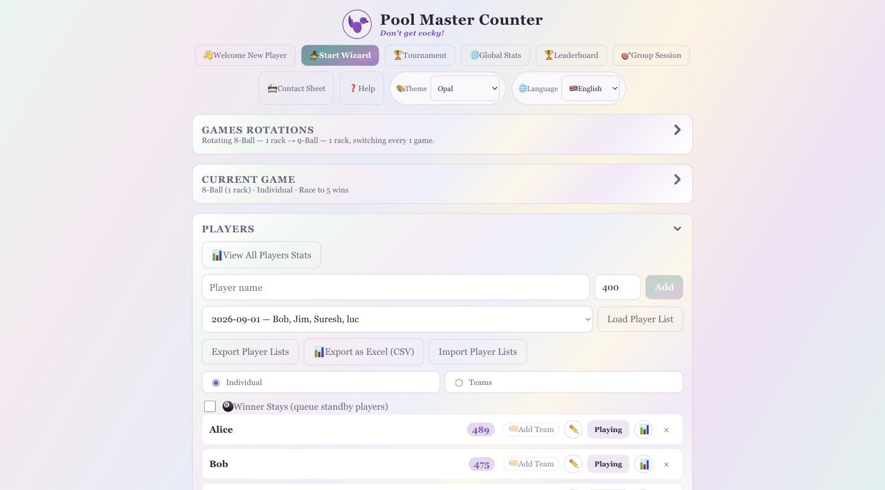

A **🎨 Theme** dropdown, pinned to the actual top-right corner of the viewport on every page, switches the whole app's colors and font in one tap and remembers the choice across reloads (applied synchronously before the page paints, so there's no flash of the wrong theme). Ten palettes, grouped in the dropdown:

- **Dark** — Crimson Felt (the original look, and the default), Emerald Rail, Neon Arcade (monospace font), Midnight Ivory (serif font), Sunset Chalk, Obsidian Break.
- **Bright** — Daybreak Chalk and Pearl Lounge, genuine light-mode palettes rather than just a lighter dark theme.
- **High Contrast** — Blackout Contrast (black/yellow/white) and Paper Contrast (white/black/blue), for maximum legibility.

Every color that needs to read clearly against an accent-colored background (buttons, toggles, badges) is computed per theme to stay WCAG-legible rather than assumed — so a button never ends up with barely-readable text just because a theme's accent happens to be dark. The graphs' own background (see [All Players](#all-players--career-stats)) gets the same per-theme treatment: a faint tinted wash of that theme's own accent color, never a flat neutral gray.

## Players & saved player lists

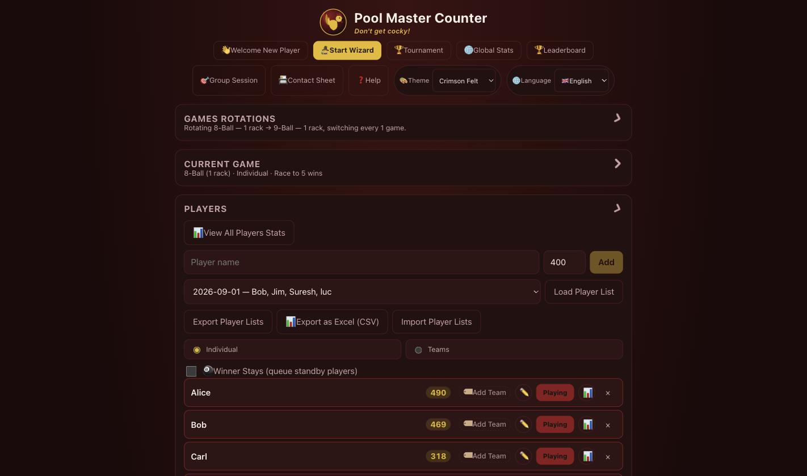

- **Add a player** by typing a name and tapping **Add**. Names are automatically capitalized ("bob smith" → "Bob Smith") and checked for duplicates as you type — the Add button stays disabled and a red note explains the conflict if the nickname is already on the roster; add a last name or initial to tell two players apart.
- **Standby / Playing** — tap a player's badge to move them in or out of the current game without removing them from the roster.
- **Remove a player** (✕) takes them off today's active list only — their career stats and game history stay on the device and still show up on the [All Players page](#all-players--career-stats).
- **Saved player lists** — pick a previously saved list from the dropdown and tap **Load Player List** to add anyone from that list who isn't already on the roster (existing players and any in-progress game are never touched or reset).
- **Auto-save** — any time the roster actually changes (a player added, removed, or a saved list loaded) or a new game is credited, the app checks whether that exact set of players is already saved. If it isn't, it's saved as a new entry in the dropdown *and* a fresh backup JSON file is downloaded automatically — so every distinct group you've ever played with is one click away, with no manual saving required.
- **Export / Import Player Lists** — a dedicated, hand-editable JSON format (separate from the full data backup) for writing or tweaking player lists outside the app. Import accepts that format, a full backup's roster list, or even a bare array of names, and never creates duplicates on repeated imports.
- **Jump to a player's stats page** — wherever a player's name appears (the scoreboard, Standings, a tournament match card, All Players), a small icon button right next to it opens that player's own [stats page](#individual-player-page) in one tap.

## Live play & scoreboard

- Tap **+** / **−** on a player's card to track balls, points, or racks toward the current game's target; each distinct positive/negative tap plays its own synthesized tone (no audio files — see [Sound](#sound)).
- Reaching the game's target banks a win for that player (or team) and starts the next game automatically.
- **Tourney win** — each card's own progress toward the session's race-to-wins milestone (a large, bold number so it reads at a glance from across the table). Completing it is a Tournament win — see [Tournaments](#tournaments-single-double--round-robin).
- **Standings** show live progress toward the race-to-wins milestone, both by team and individually.
- **Milestone, On-the-Hill, and Game Changed pop-ups** celebrate a race-to win, warn when someone is one win from it, and announce when the rotation switches game types. Winning the whole race-to-N milestone plays the same Ode to Joy fanfare a bracket Tournament champion gets — see [Sound](#sound).
- **Practice (not saved)** — in **🎱 Game** (or Current Session on the full page): a purely in-memory session; nothing is saved (no state, career stats, or ratings) until it's turned off. It asks before it goes on, and **PRACTICE · NOT SAVED** stays on the board the whole time. Wins still count live on screen for the rest of the browser tab, but none of it survives a reload — useful for a throwaway practice session that shouldn't count.
- **🔊 Sounds** (☰ Menu › Sounds) — **All**, **Wins only** (the default: a rack or race won, plus any clock or cue tick you switched on) or **Off**, and a volume. **Celebrations** there turns the big race-won screen on or off.
- **↩ Undo** (above the score cards and in each win's banner) takes back the last score — a point or a rack won — with the board exactly as it was (scores, seats, ratings), up to 20 times; **🔄 Change winner** gives the last rack to the right player, and **Recent Games** has ✏️ Edit (who won, the score) and 🗑 Delete on every game today. **Reset Current Game**, **Share Standings** (pre-filled email), and **Export Session** (JSON) are one tap away.
- **New Game** starts a fresh session; if there are unsaved games it offers to save them to career stats first, skip saving, or cancel.
- **Recent Games** lists everything played this session.

## Game Order (rotations)

Turn on **Rotate game types automatically** to have the app cycle through a sequence of game *rules* on its own — for example, one rack of 8-Ball, then three racks of 8-Ball, then 9-Ball.

- Each step in the order is its own rule — game type, target number, and unit — not just a game type, so the same game type can appear more than once with different rules ("8-Ball — 1 rack" and "8-Ball — 3 racks" as two distinct steps). Build the order with the game-type dropdown plus a target and unit field, and **+ Add to Order**; reorder or remove entries with the ↑ / ↓ / ✕ controls, or edit a step's target/unit right in the list. The list always shows each step's full rule, not just its game type.
- **Switch every N games** controls how often it advances, and the status line always shows the current rule, the next one, and how many games remain until the switch.
- **Saved rotations** work exactly like saved player lists: pick one from the **Load Rotation** dropdown to replace the current order outright (a sequence isn't something to merge), and any genuinely new sequence you build is automatically saved as a new loadable entry the moment it's set up or a game is played with it.

## Tournaments (single, double & round robin)

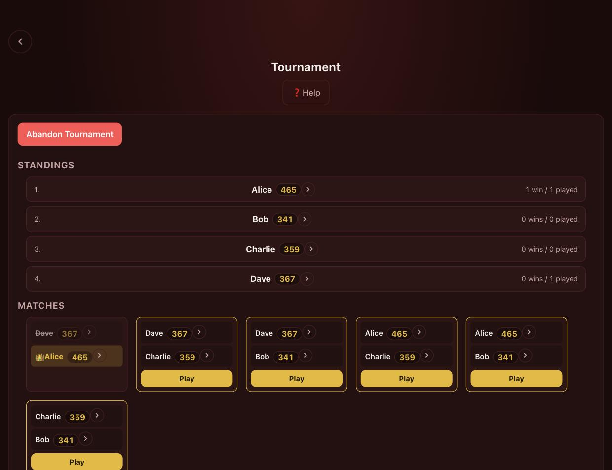

Tap **🏆 Tournament** (or choose Tournament Elimination in the wizard) to run a knockout bracket — or a round robin — instead of a regular session.

**Format** — five choices, each explained inline before you pick:

- **Double Elimination** — lose once, drop to a losers bracket for a second chance; lose twice and you're out. The default: fairer, but longer.
- **Single Elimination** — lose once and you're out. Faster, no losers bracket or grand final.
- **Round Robin** — no elimination at all. Every player faces every other player exactly once (match order is a random shuffle — there's no seeding to speak of), and once every match has a result, whoever has the most match wins is champion; a tie at the top makes every tied player a champion together. Best for a casual group where everyone should get equal games in, especially with a small group.
- **🇨🇭 Swiss** — no elimination either: a fixed number of rounds, each pairing players with similar records; the most match wins at the end is champion.
- **🪙 Chip Tournament** — chips by rating, one waiting line, out when your chips run out; see [Chip tournaments](#-chip-tournaments).

Setup is otherwise the same regardless of format: pick the game type, per-match target, race-to for each match, and check off who's competing.

- **Bracket formats** render the Winners bracket (and, in double elimination, the Losers bracket and Grand Final) as a horizontal tree with connector lines, so the whole bracket's shape is visible at a glance. Eliminated players are struck through.
- **Round Robin** instead shows a live **Standings** list — ranked by match wins, updating after every match — above a **Matches** grid showing every pairing at once (not just what's currently playable), so there's always a full view of what's done and what's left.
- Each match plays out on the same familiar +/− scoreboard used everywhere else; the currently active match is highlighted and can't be re-triggered accidentally.
- The eventual champion (or co-champions, in a Round Robin tie) gets a 👑, and the finishing fanfare plays about a second later — see [Sound](#sound).
- Every rack played in a tournament still counts toward each player's career stats, rating, and the All Players graphs — it isn't a separate, disconnected pool of data.

### 🪙 Chip tournaments

The weekly favourite: everyone gets **chips by rating** and waits in **one line**; the next two in line go to the first free table; the **loser of each game gives up a chip** and is out at 0; the **last player with chips wins**.

- **The chip chart** (in the wizard, under the format): rating bands to chips — by default 4 chips up to a rating of 399, 3 up to 549, 2 above — so weaker players have more lives. Add, change or remove bands; the chart is kept for every chip tournament after (and goes in backups).
- **Tables**: with several, the next game goes to the next free table on its own (the multi-table queue, as in the other formats); nobody plays the player they just played while someone else is waiting. A player who comes off a table goes to the back of the line, the winner first.
- **The board** shows everyone with their chips (●●○), where they are (at table 2 · next game against Jo · 3rd in line · out, 9th) and the latest games; **📺 Next up** on the TV shows the live tables, the next game and everyone's chips.
- **Late players** get their chips from the chart and join the back of the line; **a withdrawn player** is out at once. A finished game's result can't be changed (its chip has already moved the line on) — undo a rack while the game is still on the table instead.
- Final placings: the champion, then the last one out, and so on.

### 💰 Payouts, side pots and a Calcutta

Bookkeeping only: nothing is paid or charged. **💰 Payouts** on the tournament screen (the host's device) keeps the money for the event:

- **Entry fee, green fee, added money and house cut.** The prize pool is the entry fees, less the house cut (a percent of the entries, rounded down), plus added money; green fees are the house's. It updates live, late players included: "Collect $25 from each of the 16 players · Prize pool: $388".
- **A payout table by field size**, best place first, in percent: 70/30 up to 8 players, 50/30/20 up to 16, 6 places up to 24, 8 up to 32, 16 up to 64. Edit this field's row in place, or ✏️ every row (add, remove, back to the defaults); the table is kept for every tournament after and goes in backups. A shared place (single elimination's 3rd–4th) splits the places it covers. Every share is a whole currency unit; what rounding leaves over goes to the winner, so the shares always add up to the pool.
- **Side pots** (a break-and-run pot...): a buy-in times the entries, to its winner.
- **A Calcutta**: a buyer and a bid for each player; the bids less the house cut are split by where each player finishes, with the same table, and paid to their buyer.
- When it's over the champion banner says what the winner takes (and who collects the Calcutta), the placings show each place's share, and the Day Report's tournament line lists every payout, side pot and Calcutta share (the CSV has a Payouts column). Changed after the end, they follow.

### Race-to-N sessions count as Tournaments too

A regular session's race-to-wins milestone (the **Tourney win** counter on the scoreboard) is a Tournament in every stat that tracks them, on top of bracket Tournaments — reaching it credits a Tournament win for the winner (or winning team) and a Tournament loss for everyone else who was playing, exactly like a bracket champion and the players they beat. This is derived automatically from existing game history, so it applies retroactively too — every race-to-N session ever completed on a device shows up the moment this feature is present, not just new ones going forward.

## All Players & career stats

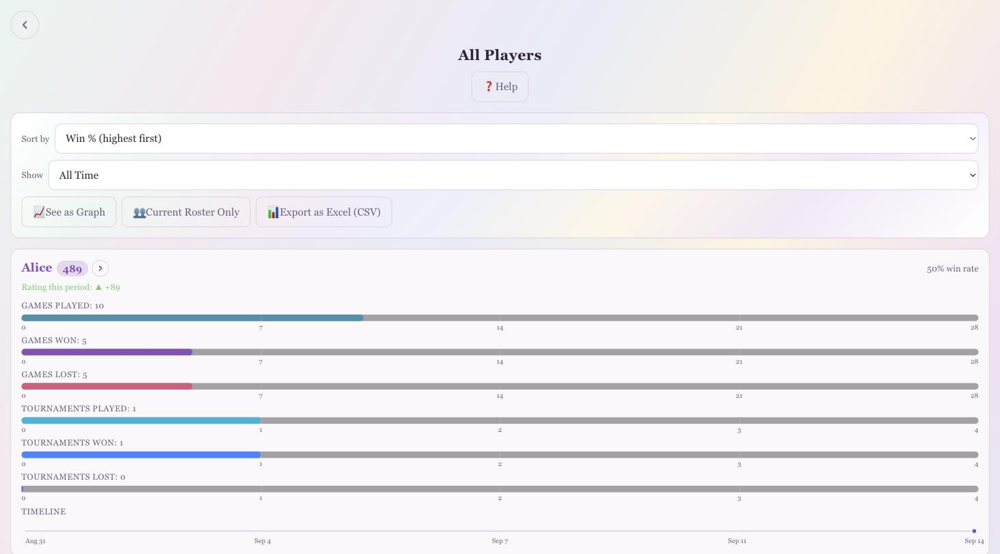

Tap **📊 All Players** to see everyone who has ever played on this device — including players no longer on the active roster and anyone who only appears in this session's not-yet-saved history.

- **Sort** by win percentage, total wins, or name, and filter the **time period** shown (Today, 1 Week, 1 Month, 6 Months, 1 Year, All Time).
- **Bar view** shows Games Played / Won / Lost as scaled bars, Tournaments Played / Won / Lost right below them (only shown for a player who's actually entered one), and a timeline of when each player played.
- **📈 See as Graph** switches to a cumulative line chart per player instead (see below).
- **👥 Current Roster Only** hides everyone not currently on the live roster, without deleting anything — turn it off to see everyone again.

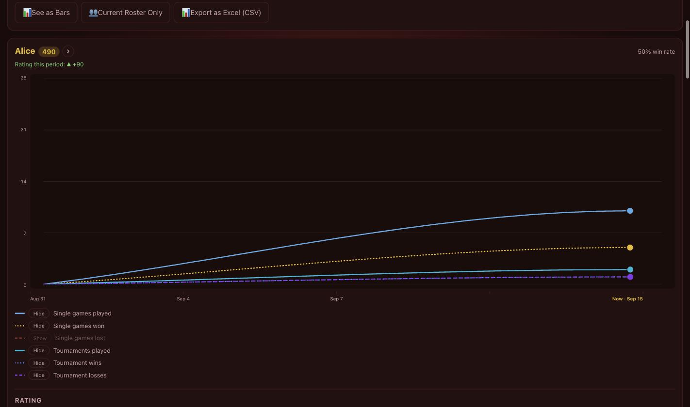

In graph view, players currently on the roster show their chart immediately; everyone else collapses to just their name and a **Show Graph** button, so the page stays scannable while every player stays one tap away. Each graph plots cumulative counts over time: **Single games** played/won/lost (with a separate line per teammate combination in Teams mode) alongside **Tournaments** played/won/lost — a fixed blue/teal/violet palette that stays visually distinct from the single-games lines (and from each other) regardless of the active theme. Curves are smoothed and non-overshooting, with a dot at each real data point and a legend where every line can be shown or hidden individually — Lost lines start hidden by default to reduce clutter.

**Tap any dot** to pop open a small window right beside it: for a single-games or Tournaments dot, every opponent behind that point and the win/loss record against each ("vs Bob — 3 wins, 1 loss"); for a **Rating** dot (the standalone chart underneath, tracking that player's rating over the same period), the exact rating at that point, this player's own change from that game, and each opponent's own rating change from the same game, so it's clear who gained and who lost. Tap anywhere else to close it.

The horizontal axis always runs to "now," with graduations matching the period selected (hours for Today, days for a week/month, dates for a year). Every player's name shows their current [rating](#player-ratings) as a small badge, and each card shows how much that rating moved in the selected period (e.g. "▲ +18").

## Individual player page

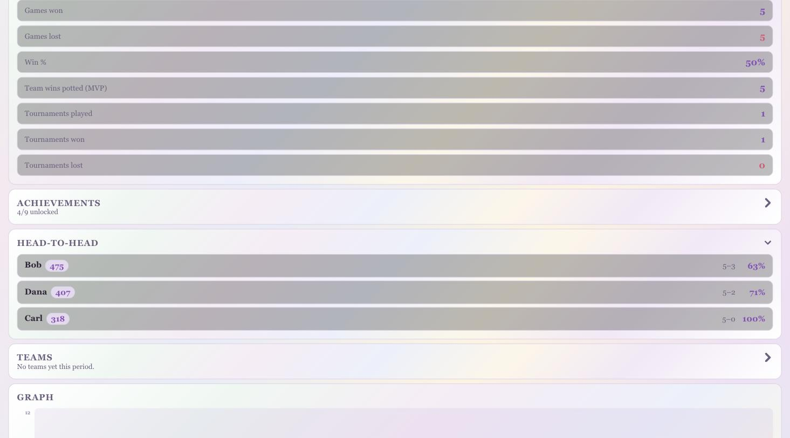

Tap a player's name (or their small icon button) anywhere in the app to open their own page. A dropdown right in the header lets you jump straight to any other known player without a trip back to All Players.

- **Stats synopsis** — current rating and how much it's moved this period, single-games wins/losses/win %, and Tournaments played/won/lost, for Today, This Week, This Month, This Year, or All Time.
- **Head-to-head** — win/loss record against every opponent they've faced.
- **Graph** — the same cumulative chart (and click-to-reveal dot tooltips) used on the All Players page, scoped to just this player, plus their Rating chart.
- **This Session (Live)** — what they've done in the game currently in progress.
- **Session History** — every past saved session, expandable into the individual games played.
- **Export Stats** saves the current live session into their permanent history; **Reset Stats** clears just this player's saved history (their name stays on the All Players list if they're still on the roster or have unsaved games; their rating is unaffected — it lives in its own store).

## Player ratings

Every player has an automatic, Elo-style rating inspired by the scale [FargoRate](https://fargorate.com/) publishes — the rating system behind USA Pool League and most competitive USA leagues. It's a roughly 0–900 scale where a 100-point gap between two ratings works out to about a 2:1 expected win ratio, doubling every 100 points (so 200 points apart is ~4:1, 300 is ~8:1). New players start at **400**.

- The rating shows as a small badge next to a player's name everywhere a name appears — the roster, the scoreboard, tournament match cards, All Players, and the player stats page.
- It updates automatically after every credited game (main scoreboard or a tournament rack), including team games (each side's average rating is used for the win-probability calculation, and the resulting change applies equally to every member of that side). New/lightly-rated players move faster for their first 20 games, then more slowly once established.
- Click a dot on the Rating graph (All Players or the player stats page) to see exactly what happened at that point — see [All Players](#all-players--career-stats).
- **There's no way to edit a rating by hand.** It only ever moves as a result of recorded games.
- Ratings live in their own name-keyed store, separate from career stats, so they survive a player being removed from the roster and are unaffected by Reset All Player Stats. They're included in the full data backup/import.

This is a from-scratch implementation matched to FargoRate's *published* odds and scale — not a reverse-engineered clone of Fargo's own algorithm, which recomputes every player's rating together in a proprietary daily global optimization and isn't something that can run client-side in a static app.

### Fargo Fair-Match races

With **⚖️ Use ratings to balance the race** on, the underdog's race is shortened from the rating gap so the match is close to a coin flip. Turn on **Use real FargoRate ratings** on the Contact Sheet and link players to their Fargo IDs there (🔎 Find on Fargo, or enter the ID): when every player in the match is linked, the race comes from FargoRate's own fair-match chart instead (the FAQ on fargorate.com, "What does a particular Fargo Rating difference mean?"). There, the two races are in the same ratio as the games each player is expected to win: the weaker player's race is the stronger player's divided by 2 for every 100 points, rounded to a whole game. In a race to 9 that's 9–8 at a 17-point gap, 9–5 at 100, 9–2 at 200 and 9–1 at 317, FargoRate's published table. The board says **⚖️ Fargo Fair-Match** and each card shows the Fargo rating it used ("Race to 5 · Fargo 500"); anyone not linked, or FargoRate off, and it's this app's own ratings as before. Tournaments with balanced races do the same, match by match.

FargoRate doesn't publish a file format for sending results in (leagues enter scores in its League Management System, tournaments go through its own tools), so there's no FargoRate export, and nothing is ever sent to FargoRate. The app only looks players up.

## Sound

Every sound is synthesized on the fly with the Web Audio API — no audio files, nothing to download. A win or loss plays a short tone; reaching a race-to-N milestone (a regular session or a bracket Tournament) plays a bigger fanfare: the full 30-note main theme of Beethoven's 9th Symphony ("Ode to Joy"), pitched low and drenched in a synthetic reverb tail for a deep, triumphant feel, starting about a second after the win is announced so it doesn't step on the announcement itself.

## Today's Notes & Day Report

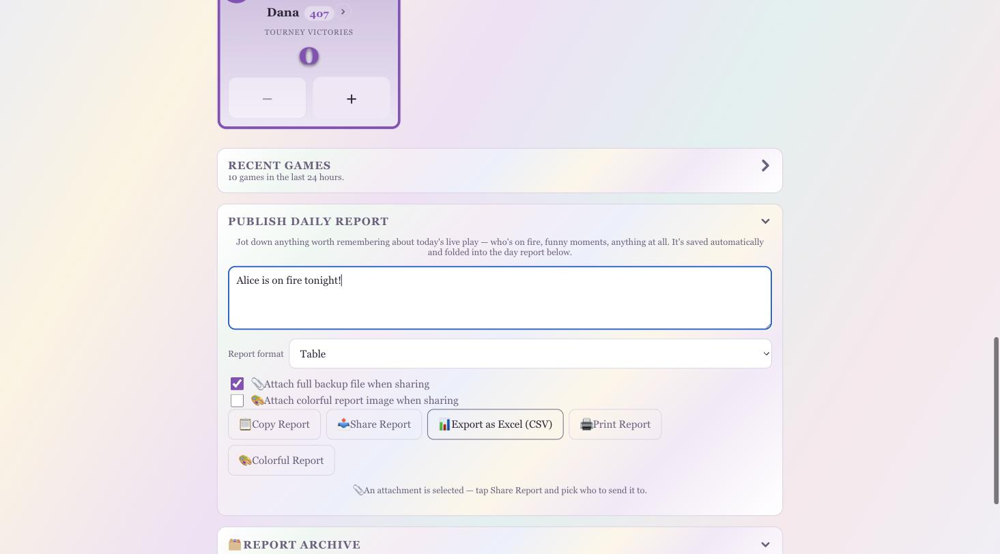

A free-text box on the main page for jotting down anything about today's live play — who's on fire, funny moments, anything worth remembering. It saves automatically as you type, keyed to the calendar date.

**Copy Report**, **Email Report**, and **Text Report** each build the same plain-text day synopsis — every player who played today with their win/loss record and rating movement, the total games played and which game types, and your notes — then copy it to the clipboard, open it in a pre-filled email, or open it in a pre-filled text message, ready to send as-is. The report is built from a merge of live and saved sessions for today's date, so it stays accurate even if "New Game" was used earlier the same day.

## Help & Guide

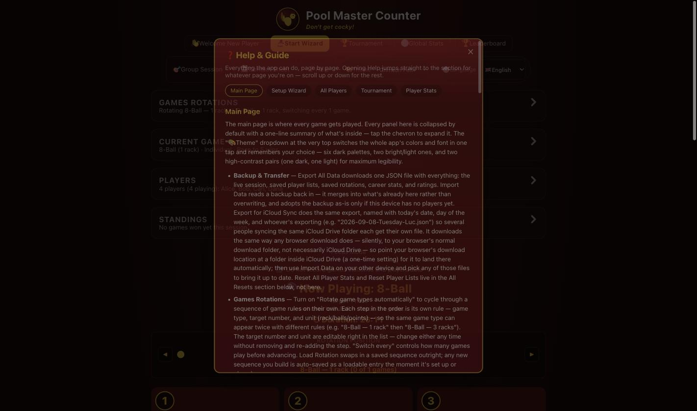

Tap **❓ Help** — it's on every page (the main page, the Setup Wizard, All Players, Tournament, and the player stats page) — to open a single guide covering every feature on every page. It's contextual: opening it jumps straight to the section for whatever page you're currently on, with a jump-nav to browse the rest. The title, intro, and nav stay pinned at the top while you scroll through a section.

## Focus Mode

The scoreboard is the home screen: the app always opens on the board (Focus Mode). Its top bar has **☰ Menu**, one line saying what's being played ("8-Ball · Race to 5 · Winner stays"), **↩ Undo** and **🎱 Game**.

- **🎱 Game** holds everything about the game: game type, target, race, rotation (with 8/9 alternate and 8/9/10 ready to pick), Winner Stays, teams (split A/B automatically), timer, shot clock and practice (not saved). Nothing changes until **Apply**, and the banner says what did.
- **☰ Menu** holds everything else: ▶️ New game, 🌙 End night (tonight's standings, MVP, best run, matchups and rating changes, one Share - text plus an optional picture card, never a backup - and the night archived), Players, Tournament, League, Stats, Day Report, Backup & Restore (the resets are in there too), Camera, Recording, Voice, Challonge, Help, Theme and Language - and under More, the Setup Wizard, Multi Tables and the full page (**🎱 Back to the board** returns).
- Each card is the name, the score, then a big **+**. A points game also has a small round − for a point taken back; undoing is ↩ Undo's job. **⇄** on a card swaps that player for someone on the bench (or someone new). The cards' drag handles only show in **☰ Menu › Players › Arrange the seats**. A card lights up for the shooter, and for a player on the hill.
- **Winner Stays**: two at the table, the rest in line. 8-Ball, 9-Ball, 10-Ball, Straight Pool, One Pocket and Snooker are two at a time - with three or more marked Playing, Winner Stays goes on by itself (the banner says so), so a rack only ever gives a result to the two who played it. The board shows the winner's streak ("🔥 Kim: 3 in a row") and who's next; seat changes are said in the banner. There's no race by default - pick **Race to n** with it in 🎱 Game for a race for each pairing (the first to it stays) - and an optional "most wins in a row".
- **Teams**: whoever's playing is split A, B, A, B. One card per team - "Team A 3 – 2 Team B" above them - with one number and one big **+**; **Credit** (or the keypad's numbers) picks who potted the winning ball, if you want to.
- With nobody playing yet, the board offers **▶️ New game**. Players added in the Setup Wizard are Playing straight away.
- **First launch** is one screen: two names (or Player 1 / Player 2), the game (8, 9, 10, Straight Pool, One Pocket), the race (5) and **▶️ Start** - straight to the board, with three tips the first time (+, ↩ Undo, 🎱 Game). Under it: more setups (the wizard: tournament, league, 3+ players, teams) and **Restore a backup**. No email, phone or rating is asked - a player's page has **📇 Email & phone** for later.

## Backup, import/export & data safety

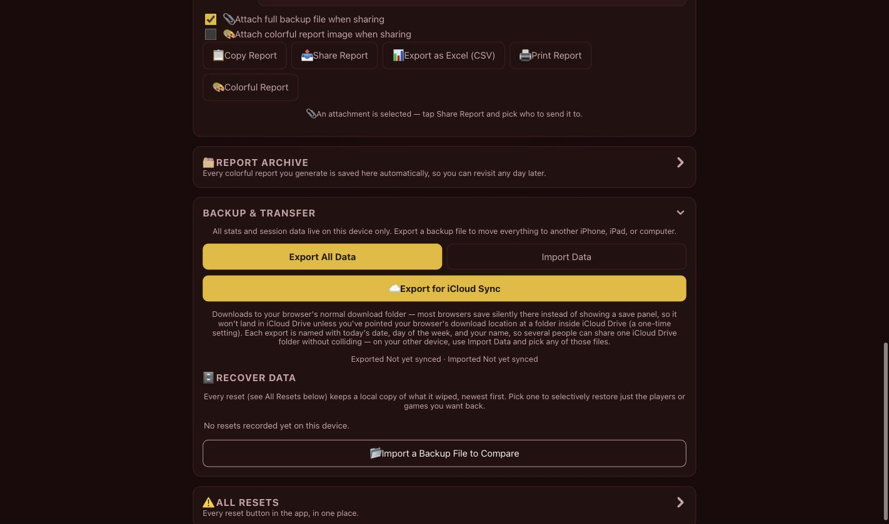

Everything lives in the browser's local storage on that one device — there's no cloud sync — so the Backup & Transfer panel (top of the page, tap the chevron to expand) is how you move data around or protect it:

- **Export All Data** downloads one JSON file containing the full picture: the live session, every saved player list, every saved rotation, every player's career stats, and every player's rating (current number plus full history).
- **Import Data** reads that file back in. If the device is brand new (no players yet) it adopts the backup as-is; otherwise it *merges*: career stats, saved lists, and ratings are combined without double-counting games already known on both sides (a rating's history is unioned and its current value recomputed from the merged, time-sorted history), new players (including anyone who only appears inside an imported saved list) are added to the roster, and the game currently in progress is left untouched.
- **Reset All Player Stats** clears everyone's saved career history (not the live session). It always downloads a full backup first and asks for confirmation, since this can't be undone otherwise.
- **Reset Player Lists** clears every saved player list from the "Load Player List" dropdown, the same way: backs up first, asks for confirmation, and the backup can be restored later with **Import Player Lists**.

## Names are case-insensitive

"Bob" and "bob" are always treated as the same person. Typing a name that matches someone already known (on the roster, in career stats, or in unsaved game history) reuses their existing capitalization instead of creating a second, fragmented player; a brand-new name gets its first letter (and the first letter of each word) capitalized automatically. If two entries already existed under different casing before this behavior shipped, the app quietly merges their history back together the next time it loads.

## Data & privacy

All data — players, stats, rotations, tournaments, everything — stays in the browser's storage on the device you're using; there's no account and no cloud of ours. A few things do leave the device, and only when you use them:

- **🎤 Voice commands** use the browser's own speech recognition, which sends what you say to Apple (Safari) or Google (Chrome) to be turned into text.
- **Camera player recognition** runs on the device, or on your own computer's server on your own Wi-Fi. It keeps appearance samples for each player (numbers describing how they look, not photos); anyone not seen for 90 days is forgotten, and **📷 Forget on camera** (on a player's page) deletes someone at once. The empty-room photo and the table's calibration stay on the device.
- **Recordings** stay on the device (or your computer) until you save or share them. Sound is off unless you turn it on, and the first recording on a device asks you to tell everyone at the table — with a printable "Camera in use" sign.
- **Your computer's server** (the desktop app) only answers devices paired with the code it shows — see `server/README.md`.
- **Sharing a report, Google Drive, Challonge and FargoRate** send what you choose to share to those services. A report's attached backup (off unless you turn it on) leaves out contacts, camera data and photos.

Clearing your browser's site data for this page, or switching devices/browsers, starts fresh unless you've exported and imported a backup first.

## Running it

This is a static site — no build step or dependencies.

- **Locally:** open `index.html` in a browser, or serve the folder (e.g. `python3 -m http.server`) and visit it.
- **Online:** enable GitHub Pages for this repo (Settings → Pages → deploy from the `main` branch) and it's live at `https://<username>.github.io/Pool-master-counter/`.
- **Desktop app (no setup):** for the "Multi Tables" feature (formerly "Group Session") (a second phone on the same WiFi joining a live scoring session) and camera-based player recognition (see `server/README.md` for both), download a portable, zero-install binary from [Pool-master-counter-releases](https://github.com/lucas1313-git/Pool-master-counter-releases/releases/tag/desktop-latest) — no git, no Node, no terminal. It also generates its own HTTPS certificate automatically on first launch, so the camera page works with no mkcert/cert setup either. These are built by `installer/` (a self-contained subdirectory, same pattern as `server/`) whenever the `release` branch (below) is pushed, so `main`'s own dependency-free footprint described above is unaffected. Published to that separate public repo, not this one, so the download links keep working while this repo is private.
- **Camera-based player recognition (optional, LAN-only):** a phone mounted over the table can recognize who's approaching and hint the tablet's keypad selection, running the relay server above with HTTPS enabled — see `server/README.md`'s own section for setup, enrollment, and mounting the phone.

Three other branches exist alongside `main`:

- **`stable`** — a snapshot of `main` at known-good points, fast-forwarded only when explicitly requested. Same unminified source as `main`.
- **`release`** — a minified build (JS via `terser` with compress+mangle, CSS via `rcssmin`) of the latest `main`, rebuilt from scratch each time rather than diffed, since it's purely derived output. Terser also renames every local identifier to a short, meaningless name, which is safe here since the whole app is one self-contained IIFE with no global `window.*` API surface. Pushing this branch is also what triggers the desktop app build (`.github/workflows/build-desktop.yml`), so the shipped binaries always come from this minified/mangled snapshot rather than directly from `main`.
- **`tests`** — the browser test suite described below. It never touches the app's own dependency-free footprint on `main`.

## Testing

A full Selenium/pytest browser test suite lives on the [`tests`](../../tree/tests) branch — it drives the real app in headless Chrome against its own static file server (no build step, matching how the app actually ships), on a clean `localStorage` per test. It's kept off `main` so the shipped app stays exactly as dependency-free as described above; only the test suite itself needs Python packages.

Coverage includes cold boot, scoreboard scoring/win-detection/undo/the milestone overlay, all 10 themes (including the graph-background-color fix), the All Players bar/graph views (including a regression test for the graph-overflow fix), the Player Stats synopsis/switcher/dot tooltips, a full bracket Tournament played to completion, and the no-stats-mode persistence guarantee. See `tests/README.md` on that branch for setup and run instructions.

## Project structure

- `index.html` — markup for every view: the main scoreboard, the Setup Wizard, the Tournament page, the All Players page, and the individual player page
- `css/style.css` — responsive, touch-friendly styling, theme colors, and layout for every panel and overlay
- `js/app.js` — all app state, localStorage persistence, sound synthesis, and UI logic (single IIFE, no framework)
- `docs/screenshots/` — the screenshots used in this README
- `players/`, `settings/`, `stats/` — legacy data files from an earlier version of the app that stored data as JSON committed to the repo; kept only so a device's first launch can migrate that history into local storage. The app never writes to these directories anymore.
